  

 

  I keep Linux servers running and replace repetitive work with scripts. 
  After hours I build full-stack projects and study how AI can drive automation.

 

 

<h3 align="center">Skills</h3>

  

 

 

<h3 align="center">Now</h3>

  Automating infrastructure tasks with Bash and Python 
  Learning AI-driven automation workflows 
  Solving a LeetCode problem every day 
  Building side projects in React, FastAPI and Node 
  Watching for production outages

 

 

<h3 align="center">Work</h3>

  My selected work is in the pinned repositories above.

<!--
  To list a project here, copy this block, then replace the repo name and the description:

  <a href="https://github.com/SuperAdmin777/REPO-NAME"><b>REPO-NAME</b></a> 
  One honest line about what it does.

-->

 

 

<h3 align="center">Contact</h3>

  Need a hand with Linux servers, automation or a quick script? 
  Message me on <a href="https://www.linkedin.com/in/abhay-jasrotia-907487236/">LinkedIn</a>.

<!--
  Add other links only when they point to your real profiles, for example:
  <a href="https://leetcode.com/u/YOUR-NAME/">LeetCode</a> &middot; <a href="https://t.me/YOUR-NAME">Telegram</a>
-->

 

<i>Discipline beats motivation.</i>

  

Fan tribute. Musashi artwork is from <i>Vagabond</i> by Takehiko Inoue, not my own work.

